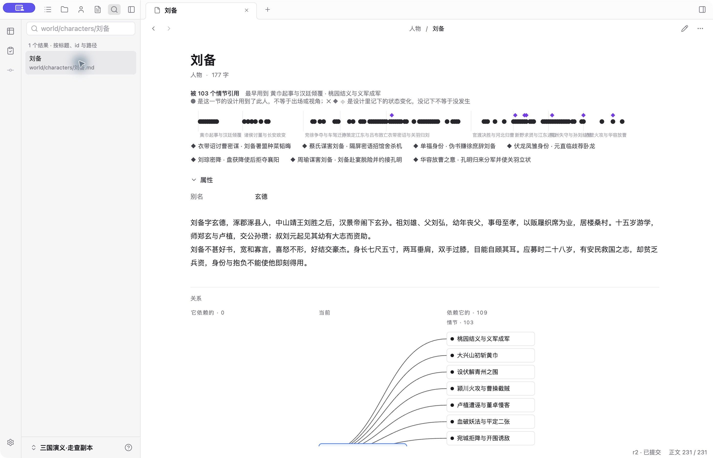
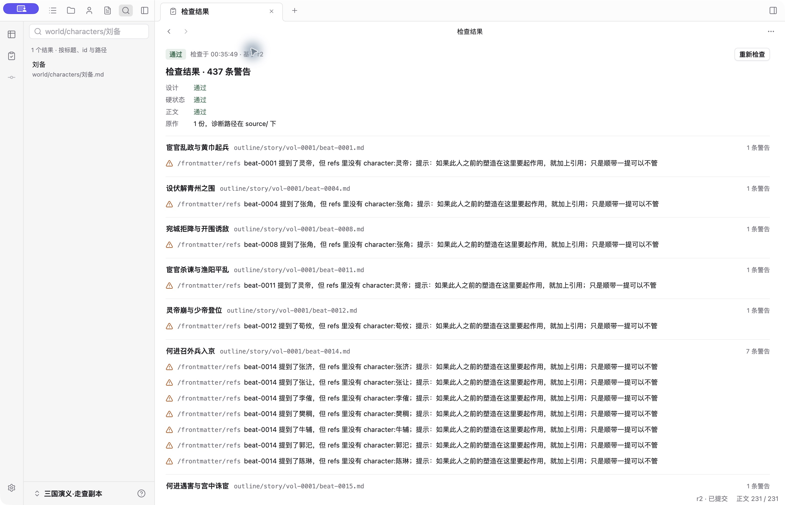
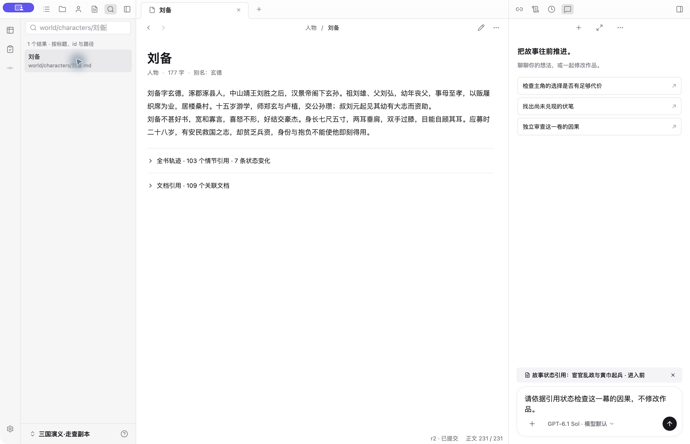

# 桌面作者流程走查（2026-10-07—10）

使用真实 Electron 生产入口，在隔离配置与 `examples/sanguo` 副本上操作；231 个情节、408 个人物。截图来自本次原生窗口。没有修改作者作品、凭据或全局配置，也没有把自动化的 faux 回复当成真实创作质量证据。

## 流程与反馈

| 步骤 | 现场结果 | 反馈与处理 |
| --- | --- | --- |
| 1. 首次进入 → 打开作品 | 已修复并复验 | 未操作就显示「请先打开或创建作品」。主进程改用明确的空工作区错误码，欢迎页只忽略这一种正常空态；真正打开失败仍显示原因。 |
| 2. 浏览设计 → 正文 → 故事状态 | 已修复并复验 | 导航、前后状态与依据引用可用。状态正文原把「读者期待」写成「承诺」，已在共享文本源头统一，领域字段不变。 |
| 3. 全书故事轴 → 适应窗口 | 已修复并复验 | 4px 列宽下限让 231 节无法装入中间窗格，按钮却已显示选中。适应窗口允许小数列宽，标记同步缩小；手动缩放也从实际比例开始。 |
| 4. 编辑正文 → 保存 → 查看差异 | 通过 | 保存后明确显示「已保存，尚未提交」和 1 个文件未提交；差异准确呈现新增句子。 |
| 5. 提交版本 → 回看 r2 | 通过 | 提交后未提交数清零，r2 对照父版本 r1 展示同一段改动。 |
| 6. 引用状态 → 输入要求 → 重载 | 通过 | 引用和未发送草稿完整保留。 |
| 7. 无模型配置 → 发送 → 纠正配置 | 已修复并复验 | 模型预检失败也进入「上次发送尚未确认」，再试仍失败，模型选择被锁住。首次请求明确被预检拒绝时退回可编辑草稿，文字、引用和等待期间的新输入全部保留；提示旁直接提供「配置模型」。 |
| 8. 设置 → 模型与提供商 | 已观察 | 分类和模型菜单可打开、可退出；本轮未登录提供商，也未发送真实模型请求。 |
| 9. 搜索 → 打开资源档案 | 通过 | 搜索「七星」返回 5 个标题 / id / 路径匹配；打开「七星宝刀」后展示对应资源与持有者。 |

**保留的优点**：作品与对话同时可见；保存候选和提交版本的反馈有清楚区别；同一个引用可以从状态观察进入对话；版本比较保留具体文本，能核对提交结果。

优先级：发送被拒绝后无法纠正配置为 P1；首次启动误报与整书缩放失效为 P2；术语一致性为 P3。以上四项均已修复。

## 修复边界

发送结果不明与明确未发送分开处理。只有首次请求返回已核实的模型预检错误，才退回草稿。未知错误、回包丢失和已经进入确认流程的重试继续保留原命令 ID；不能因重试时配置又出了问题就把此前可能已接收的消息重新发送。修复复用现有 ComposerDraft、CommandError 和 IPC，不新增执行状态或消息协议。

故事轴全书模式是概览；缩到整本书时，单节标记会变小，可放大或进入卷查看细节，不把最小可点击尺寸误用为概览的列宽下限。

## 截图

- [首次进入，修复前](images/01-welcome.png)
- [作品设计与 Agent](images/02-workspace.png)
- [长篇故事轴，修复前](images/03-axis-before.png)
- [故事状态与术语问题](images/04-story-state.png)
- [保存后的差异](images/05-diff.png)
- [提交后的版本对照](images/06-version.png)
- [首次进入，修复后](images/08-welcome-after.png)
- [长篇故事轴，修复后](images/09-axis-after.png)
- [故事状态，术语统一后](images/10-state-after.png)
- [发送被拒绝并重载后，草稿与引用仍可编辑](images/11-draft-after.png)
- [从提示旁直接打开模型设置](images/12-settings-after.png)

发送失败的修复前截图包含临时配置文件路径，只作为本机诊断，不纳入公开记录。

## 验证

新增真实 Electron 回归覆盖欢迎页、错误目录、创建作品、未配置模型发送、草稿与引用恢复、设置入口和 231 情节的整书适应窗口。原有回包丢失重试用例继续验证同一命令不会重复入 inbox；新增纯函数用例验证拒绝时保留并发输入与迟到回包不串草稿。

2026-10-08：`npm run check` 通过；`npm test` 471 项，466 通过、5 项既有集成测试 skip；`npm run test:desktop` 24 / 24 通过。其后仅统一故事状态文案，相关用例先红后绿、全仓检查与测试重跑通过，并在重新打开的生产窗口中确认。

原生窗口复走确认：欢迎页无误报；故事轴显示全部 9 卷、231 个情节；引用状态后发送被模型配置检查拒绝，原要求与引用回到输入器，重载仍在且模型选择可用；「配置模型」直接打开设置。编辑、提交与版本比较的正文使用隔离副本。

证据范围：桌面功能与故障路径已有实测和自动化覆盖；模型正常回复、停止与恢复由 faux E2E 验证，本轮未登录或调用真实 provider。2026-10-08 作者看过修复后的全书概览截图，确认当前密度「合适」，保留全书概览，不改为默认突出当前卷；这项确认只覆盖概览密度，发送恢复等交互仍待作者实际使用反馈。这里只证明已走过的产品流程，不声称完成真实长篇质量或所有系统平台的验收。

## 第二轮：历史版本与窄窗（2026-10-08）

1. **打开 r2，对照父版本 r1：通过。** 宽窗口可逐字核对提交前后内容，正文两侧只读。[宽窗修复前](images/14-version-wide.png)。
2. **缩到 960×640：已修复并复验。** 内容区约 672px，原实现仍硬分双栏，中文换行过密；现在复用独立比较页的组件与 760px 阈值，窄窗自动单栏，宽窗恢复并排。[窄窗修复前](images/15-version-narrow-before.png)、[窄窗修复后](images/16-version-narrow-after.png)、[宽窗修复后](images/17-version-wide-after.png)。移除了版本页私有的双列表头，沿用共享表头、分隔手柄与滚动联动。
3. **延迟及失败读取：已修复并通过故障注入。** 加载清单期间不再同时出现「这个版本与父版本内容相同」；清单和正文读取失败分别提供「重新读取版本」「重新读取正文」，错误带 alert 语义。测试闸门固定加载时点，再分别注入一次 IPC 读取失败，重试后读取真实作品数据，不以固定延时碰运气。
4. **重载与放宽窗口：通过。** 生产窗口重载显示新布局；原有未发送草稿与状态引用仍在。放宽后恢复并排，自动化另外核对两侧原文、所有编辑器只读以及作品文件未改变。

本轮是既有比较能力的 UI 修正，没有新增领域状态或持久协议。历史版本下拉仍平铺所有 revision，数百版本的导航还未优化，不算本轮完成。截图可确认排版和可见控件，未运行屏幕阅读器，不据此宣称全面无障碍达标。窄窗阅读密度已向作者征求反馈，尚待回复；此前「合适」只指全书故事轴概览。

验收：新增历史版本 Electron 回归先复现加载误报，再验证失败重试、两种布局和只读边界。`npm run check` 通过；`npm run test:desktop` 25 / 25 通过；文档更新后链接检查与 `git diff --check` 通过。本轮只改 renderer 与桌面测试，未重复运行首轮已通过的 471 项非桌面测试，也未调用真实 provider。

## 第三轮：跨页面信息层级审查与方案（2026-10-10）

**本节记录实施前的审查与提案；已落地范围见第四轮。** 作者指出历史版本页的横线过低、属性占行过多，随后要求检查其他页面并设计统一方案。本轮复走生产 Electron 的隔离示例副本，在 1460×940 逻辑窗口截图；没有修改作品正文、模型配置或生产 UI。之前通过的 25 条桌面 E2E 证明功能回归，不证明这次的信息层级已经合理。

### 逐页证据

| 步骤 / 页面 | 现状与健康度 | 优化建议 | 证据 |
| --- | --- | --- | --- |
| 1. 历史版本 | 需重构。标签、导航、下拉、大标题重复 r2，比较内容前堆叠四层；底部另占一行解释口号。 | 合并版本选择与比较关系；文件选择、差异导航就近组织；删除重复标题与口号。 | [18](images/18-version-audit.png)，`VersionPage` |
| 2. 创作意图 | 内容可读，空关系图冗余。book 没有出入引用，仍画中心节点、两个零计数和解释。 | 保留文档标题；无关系时不渲染空图，保留按需查看入口即可。 | [19](images/19-intent-audit.png) |
| 3. 情节设计 | 有同类问题。标题、类型字数、属性折叠标题、人物列表均在正文前；当前 9 人仅一行，仍占一个独立属性区。属性默认展开由共享组件决定，字段增多会继续推后正文。 | 参与者、依赖和变化直接展示；减少容器标题和留白，不一律折叠长列表。 | [20](images/20-design-audit.png)，`Props`、`propertyRows` |
| 4. 人物 | 最明显。丁原只有 59 字，前面先放全书轨迹；刘备 177 字介绍前还有轨迹解释、7 条事件、别名属性。卷名在迷你轨迹上拥挤重叠。 | 标题下保留短身份信息，接介绍；轨迹与事件成为独立可展开区域，保留「103 个情节引用」等摘要入口；关系图按需展开。 | [22](images/22-character-audit.png)、[23](images/23-character-long-audit.png)，`CharacterTrack` |
| 5. 正文阅读 | 基本合理。没有属性表，但应用情节标题与稿内原著章节标题连续出现。两者语义不同，不能据此删作品标题。 | 保留作品原文、字号与行距；应用生成的情节名移入导航上下文或紧凑页头，正常字数和时效并入已有状态区域。过期、冲突等仍明显可见。 | [21](images/21-prose-audit.png) |
| 6. 检查结果 | 需整理。先有总通过，再逐行设计通过、硬状态通过、正文通过，之后才进入 437 条警告。 | 一行总结果与分类摘要；主体优先显示可处理诊断，支持严重性 / 文件 / 诊断类型筛选。保留总数、筛选数与完整诊断，不把警告隐藏成通过。 | [24](images/24-check-audit.png)，`CheckPage` |
| 7. 设置 | 基本合理，局部文字冗余。模型配置说明和默认模型说明重复「用于新对话、临时选择独立」。高级参数已折叠，表单空间并非无效。 | 合并重复说明，说明紧贴对应字段；保留分类与表单布局，不套用正文页的紧凑度。 | [25](images/25-settings-audit.png) |
| 8. Source / 通用文件 | 未发现同类顶部堆叠。原作入口直接打开 material.txt，面包屑之后就是内容。 | 维持布局；原文过宽是阅读宽度的独立问题，不混入本次页头整改。 | [26](images/26-source-audit.png) |
| 9. 故事轴 | 主体占比合理。操作集中一行，图例已按需打开；全书密度此前已获作者确认。 | 保留主体密度；公共工具栏合并时避免再新增一层页头。 | [27](images/27-axis-audit.png) |
| 10. 故事状态 | 中度堆叠。标题、观察位置标签与名称、更换位置、三态、范围、版本和解释分多行。 | 观察位置直接成为选择控件；三态单独一行；基线、范围紧凑呈现，完整语义解释按需打开。当前观察点、前后时点和提交基线必须保持可见，引用语义不变。 | [28](images/28-state-audit.png) |
| 11. 审稿 | **源码确认的布局风险，本轮没有视觉复验。** 上部完整结论和所有 findings 最多占 45%，下部固定两列全文，底部又有独立操作栏。当前示例没有审稿，未伪造报告补截图。 | 结论摘要 + 可选择的问题列表 + 当前问题证据；宽窗列表和证据相邻，窄窗用问题选择器与被审稿 / 当前稿切换。复核单条和整份报告的作用域明确区分。 | `IssuePage`，落地前补带长摘要、多 finding、过期报告的截图 |

### 按页面任务分配信息顺序

作者明确指出不同页面需求不同。方案修订为分别安排各页信息顺序；共用基础控件，不统一“正文优先”或默认折叠规则：

- **人物**：别名与人物介绍构成概览；家族关系和开场状态保留明确标注，全书引用轨迹在介绍之后按需展开。引用、出场和当前时点状态不能混同。
- **情节设计**：参与者、依赖、期待与本节变化就是设计工作内容，保持直接可见；去掉冗余容器标题，不为了首屏整齐隐藏关键事实。
- **正文与意图**：保留文档阅读结构、作品原始标题、字号与行距；没有关系时不画空图。
- **读者期待、地点、资源与秘密**：各有独立核心问题。读者期待进展与期限不因人物轨迹折叠而跟着折叠；其他对象须补现场走查再决定顺序。
- **核对与处理**（历史版本、当前稿比较、检查、审稿）：紧凑上下文和操作区之后直接进入差异或问题。历史与草稿比较共用布局、差异导航和宽窄适配，但历史只读、草稿可编辑的语义保持独立。审稿按 finding 浏览，Checker 按确定性诊断浏览，不把二者揉成一种业务模型。
- **结构探索**（故事轴、故事状态）：保留观察范围与时间点，操作紧邻对象；图例和长解释按需打开。正常状态收敛，过期、未知与缺失证据不能消失。
- **配置**：继续使用分组表单，去掉重复解释，保留必要标签、保存反馈与认证状态。

具体共性规则：

1. 一个事实在同一工作面只保留一个主要展示位置；导航上下文与文档标题有不同用途时可以同时存在，但不再补一个重复标题区。
2. 正常状态进入紧凑摘要 / 既有状态栏；会改变作者判断的失败、冲突、过期信息仍在动作附近显式展示，不为了省高度藏到 tooltip。
3. 是否展开由各页工作目的决定；不按字段数量统一折叠。展开状态留在现有工作区 view state，切换、重载与分屏不能互相污染，不增加 Runtime 状态。
4. 有内容才画关系图。零关系不画空节点；复杂关系先给可理解的数量和入口，作者请求看图后再占据主要空间。
5. 文件、版本和 finding 数量增长时用可搜索或可筛选的列表；当前选择始终可见，不能只有隐藏菜单。长篇不靠不断增加横向胶囊或固定侧栏解决。
6. 共享的是 `PanelToolbar`、比较组件、属性容器、提示和布局 token；不引入配置驱动的通用页面引擎。`DocumentToolbar` 使用页面动作插槽，`Props` 继续消费 `propertyRows`，`MiniTrack` 不新增领域投影。审稿证据保留自己的语义。
7. 保持既有中文字号、阅读宽度与正文行距。通过减少重复层、选择默认展开范围获取空间，不统一缩小控件。

### 分步落地与验收

先做版本工作面与人物 / 设计页，分别验证差异核对、人物概览与设计事实的排列；然后做审稿与检查，最后整理状态栏和设置说明。此顺序同步到路线图第 6 节；本提案不等于作者已经选定视觉方案。进入实现时先用真实内容给出完整工作面的预览，再按选定方向落到生产。

验收使用 1460×940、960×640 和分屏后的实际内容宽度，既测文字很少也测长标题、多属性、几百版本、多 finding、上百诊断：

- 普通版本状态下，从文档工具栏底边到比较正文区域不超过两行控制区（初始目标 88 CSS px，包含比较表头）；长标题可换行，不能裁掉路径或动作，危险操作确认不受该限制。
- 人物页默认状态下首屏必须出现介绍，派生轨迹不能把介绍推后；情节设计页保留完整设计事实，不以正文首屏位置作为唯一标准。展开后全部内容、关联跳转仍可访问，用户主动展开不受首屏目标限制。
- 空关系不生成占位图；迷你轨迹的卷名不重叠，键盘可访问等价文本与锚点。
- 检查结果的总量与过滤量一致；筛选没有结果、部分未执行、重新检查失败、结果过期都有不同的反馈。
- 比较和审稿的选中对象、当前版本、滚动位置在窄窗和重载后保留。比较保持只读 / 可编辑边界；UI 调整不写作品。
- Tab、Enter、Escape 可完成展开、选择、关闭、跳转；焦点可见且返回原触发处，计数和状态不能只依赖颜色；折叠详情用明确名称与展开状态，完整路径可复制。

本轮未运行屏幕阅读器、对比度测量或新增功能回归。审稿、读者期待、地点 / 资源等未逐一现场复验；对它们的结论限于共享组件和源码结构，不能视为全页面无障碍或响应式验收。本次审查时尚未修改生产代码；后续实施独立记录。

### 两个主要问题的原生截图

人物介绍被派生信息挤到下方：

检查结果先重复列出正常状态，再进入大量警告：

## 第四轮：版本与人物工作面优化（2026-10-10）

作者确认开始优化后，按 [ADR-0016](../../adr/0016-page-information-hierarchy.md) 落实分别设计的布局：

- 版本页合并版本和文件选择，删除重复大标题与底部口号。文件可搜索并显示增删改类型；上一处 / 下一处差异、布局与选项复用比较工具栏。历史与候选两侧保持只读，不显示逐块还原。完整版本标识移至详情，恢复确认明确作用于整个作品。
- 人物页把别名并入标题下的信息行，先显示介绍，再显示家族和开场状态；全书轨迹以引用数和变化数作为展开入口，选择随页面保存。展开后事件列表包含全部记录的状态变化，可跳到对应情节；不把引用称为出场。人物迷你图不再堆叠卷名，完整卷名出现在锚点提示与事件列表。现场第一版仍有过大的默认引用图，第二次迭代把文档引用图也改为单独展开；家族关系保持直接可见。
- 情节设计去掉“属性”容器标题，参与者、依赖、期待和变化仍直接可见。其他对象保留原属性折叠方式；无出入关系的页面不渲染空图。

检查、审稿、故事状态与设置仍在队列中；本轮未更改其业务布局。

### 现场复验

生产 Electron 中保留原有对话草稿与故事状态引用，刷新后确认新界面可见；未发送消息、未改作品。实际操作了差异跳转、文件搜索的无结果状态、人物轨迹展开，以及左右分屏再合并。下列截图均已逐张检查。

| 工作面 | 实际结果 | 截图 |
| --- | --- | --- |
| 版本宽窗 1460×940 | 版本与文件同一行，后接比较表头；无重复大标题和底部口号。 | [29](images/29-version-compact-wide.png) |
| 版本窄窗 960×640 | 自动单栏，导航、选择与详情均可见；跳转定位到已知新增句。 | [30](images/30-version-compact-narrow.png) |
| 人物第一版 | 介绍已提前，但引用图仍占据大量空间，因此没有直接交付这一版。 | [31](images/31-character-overview-wide.png) |
| 人物最终宽窗 | 别名并入摘要；177 字介绍完整显示，103 次情节引用与 109 个关联文档分别提供入口。 | [32](images/32-character-overview-final.png) |
| 人物轨迹展开 | 轨迹与 7 条变化均可读，图内卷名不再堆叠。 | [33](images/33-character-track-expanded.png) |
| 人物窄窗 | 介绍仍在首屏，两处展开入口均可见。 | [34](images/34-character-overview-narrow.png) |
| 人物与版本分屏 | 人物概览与单栏差异可并行查看，版本控件未被裁切。 | [35](images/35-character-version-split.png) |
| 无引用的创作意图 | 阅读内容下不再出现空关系图。 | [36](images/36-intent-without-empty-graph.png) |
| 情节设计 | 9 位相关人物直接可见；保留设计文本和结构关系，未套用人物页折叠规则。 | [37](images/37-design-visible-properties.png) |

### 验证边界

最终验证：`npm run check` 通过，工作台单元测试 66 / 66 通过，完整桌面 E2E 25 / 25 通过（2026-10-10）。本轮只调整界面与对应交互断言，未重跑全仓单元测试。

新增的桌面断言先在旧界面复现版本页顶部过高、人物轨迹缺少独立展开区；随后覆盖搜索、切换文件与重载选择、历史只读边界、宽窄自适应、人物介绍和轨迹的几何顺序、轨迹及文档引用的展开恢复、空关系图省略。情节设计原有“属性可折叠”断言改为关键属性直接可见，候选页的大标题断言改为版本选择器，继续守住原操作路径。

宽窗普通版本状态的文档工具栏底边至比较正文区域不超过 88 CSS px；窄窗与分屏另有现场视觉复核。尚未做几百版本压力测试、屏幕阅读器验证或本轮真实模型调用，不能据此宣称其他页面已完成优化。
