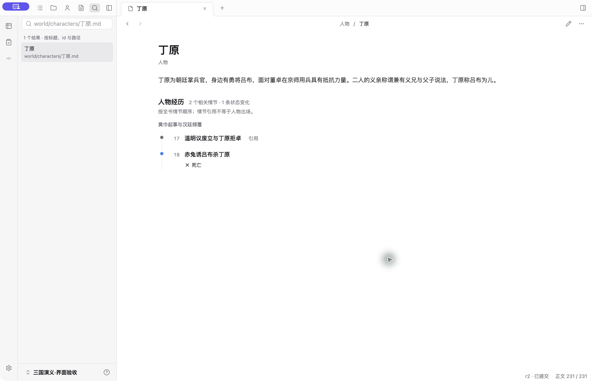
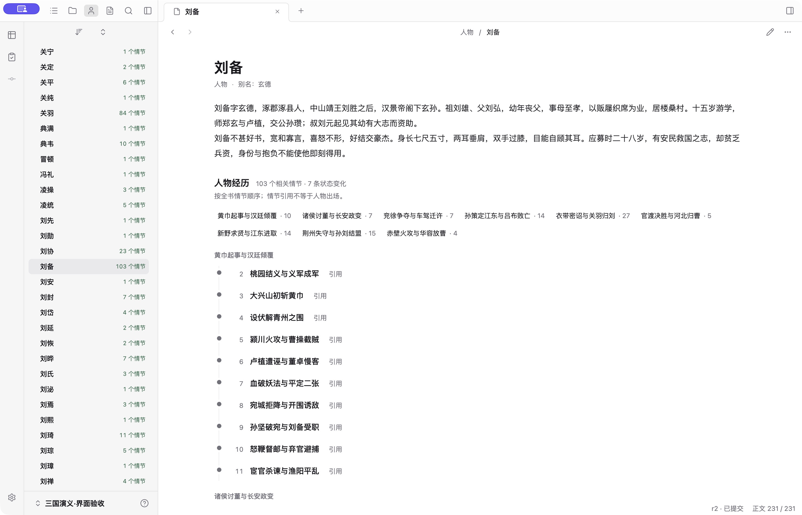
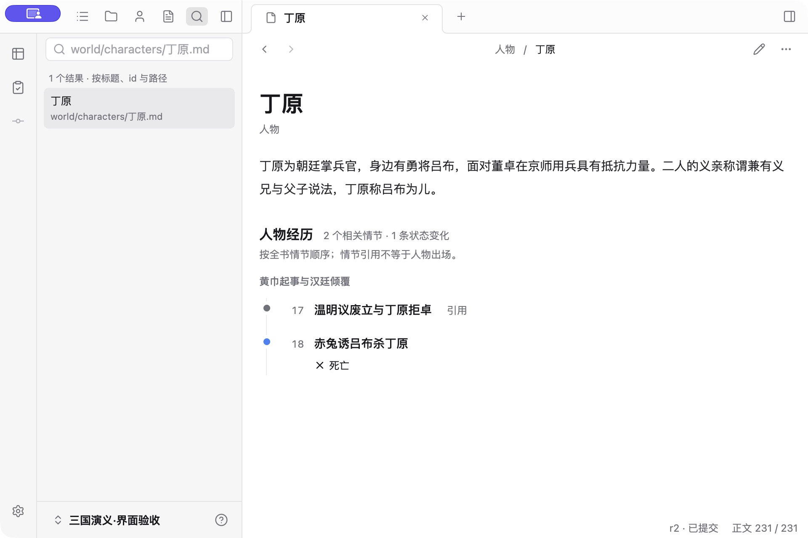
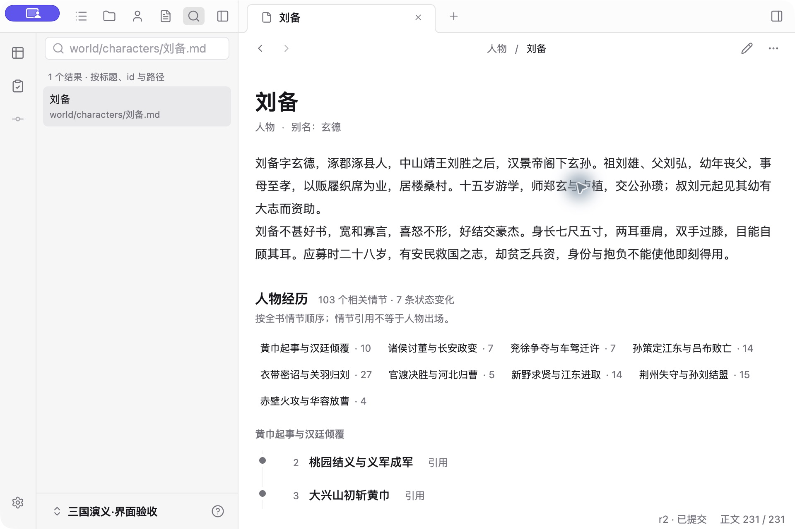
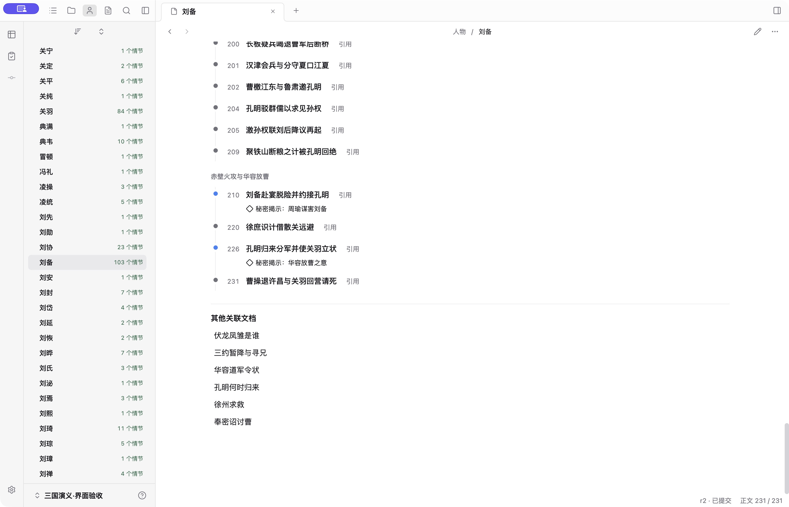
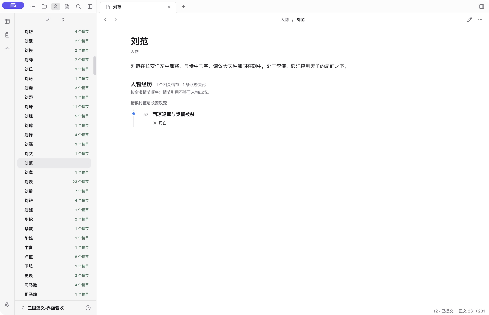

# 人物经历直接展示：反馈后的迭代

作者否定了人物页默认折叠：丁原只有介绍和两个需要点击的入口，重要信息与可视化都不可见。本轮采用 [ADR-0018](../../adr/0018-character-experience-visibility.md)，替代此前的人物折叠方案。

## 真实桌面走查

生产 Electron，使用仓库《三国演义》示例副本，宽窗 1460×940、窄窗 960×640。刷新原窗口确认新界面生效；截图为原生窗口捕获，不是设计稿。

- 丁原：介绍之后直接呈现第 17 节引用、第 18 节死亡，后者没有人物引用也能显示；两个节点都可打开来源，页末不重复第 17 节。
- 刘备：103 个相关情节按九卷组织，7 条状态变化随情节出现。点击末卷可定位，页末保留其他关联文档。第一版每条引用单占两行过长，现场迭代为普通引用一行、状态变化增加说明行。
- 刘范：人物引用为零，仍展示第 57 节死亡记录，不把“没有引用”当成“没有经历”。
- 窄窗：丁原两条经历完整出现在首屏；刘备介绍、分卷导航和首个节点可见，长标题正常换行。

| 丁原：直接展示 | 刘备：密集经历 |
| --- | --- |
|  |  |
|  |  |

## 验收边界

定向 Electron 4 / 4 通过。覆盖默认内容可见、无人物引用的死亡节点、来源跳转、节点不重叠、稀疏人物首屏、按卷分组、窄窗不溢出；进一步补跨卷定位的焦点断言。最终 `npm run check` 通过，工作台单元测试 66 / 66、完整 Electron E2E 25 / 25 通过。首次完整回归为 24 / 25：新经历链接默认可见后，状态查询测试的全页选择器同时匹配搜索结果与经历链接；改为定位搜索结果后，完整重跑通过。

这轮验证界面与既有数据的呈现，未调用真实模型，未验证自动提取质量，也不把文档引用推断成人物社交关系。作者对新版的实际使用反馈尚待收集。
