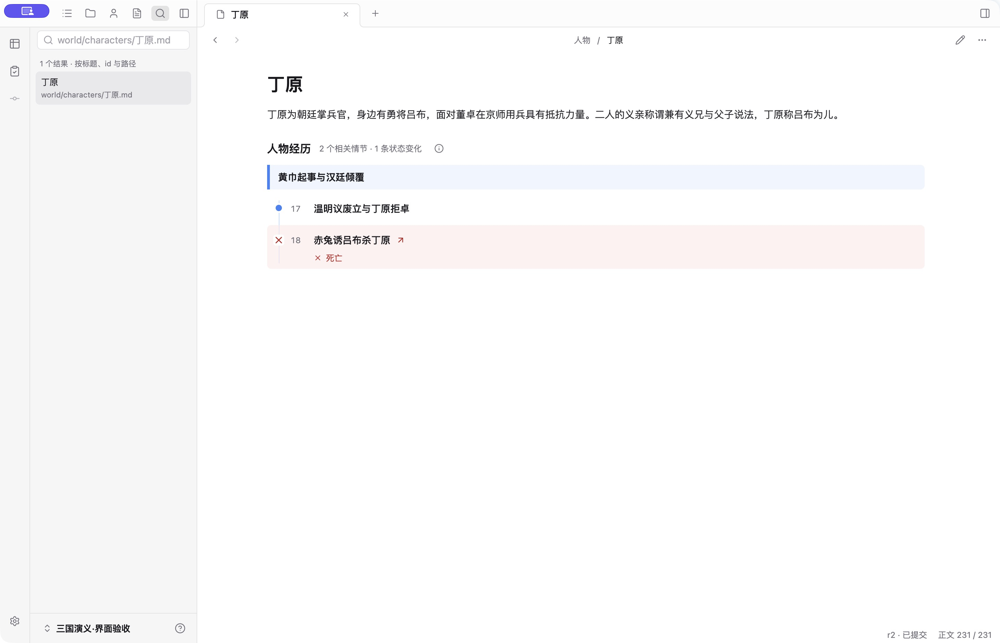
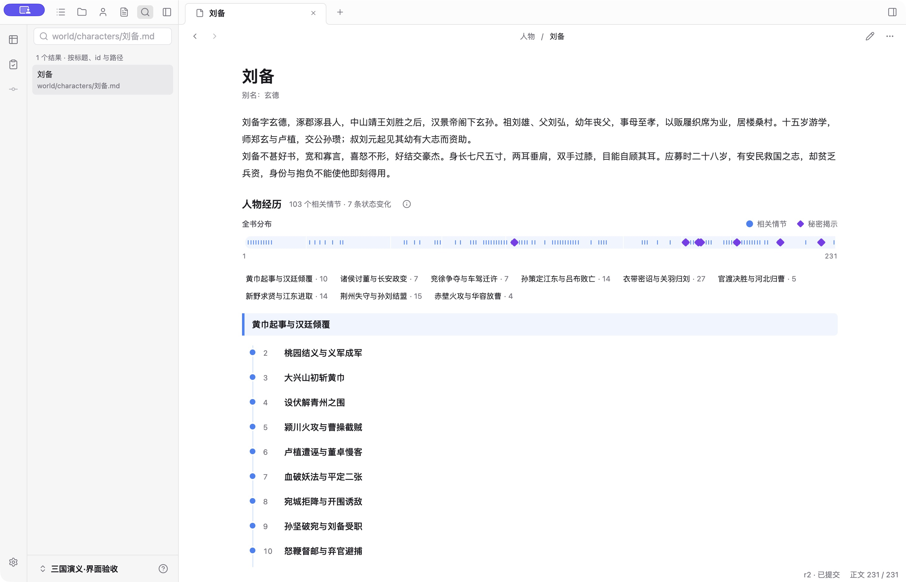
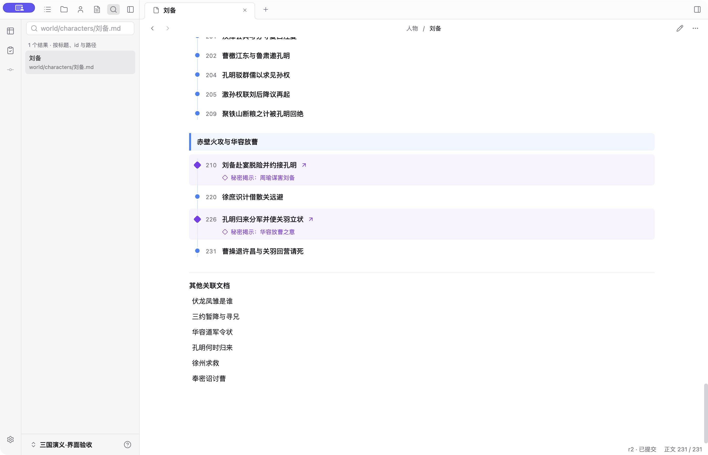
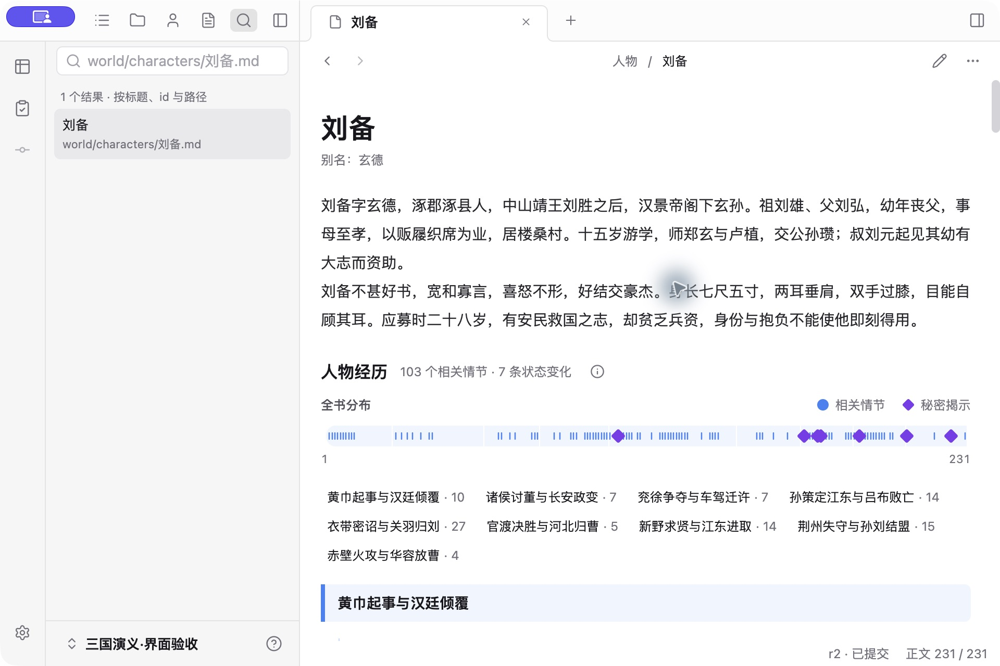
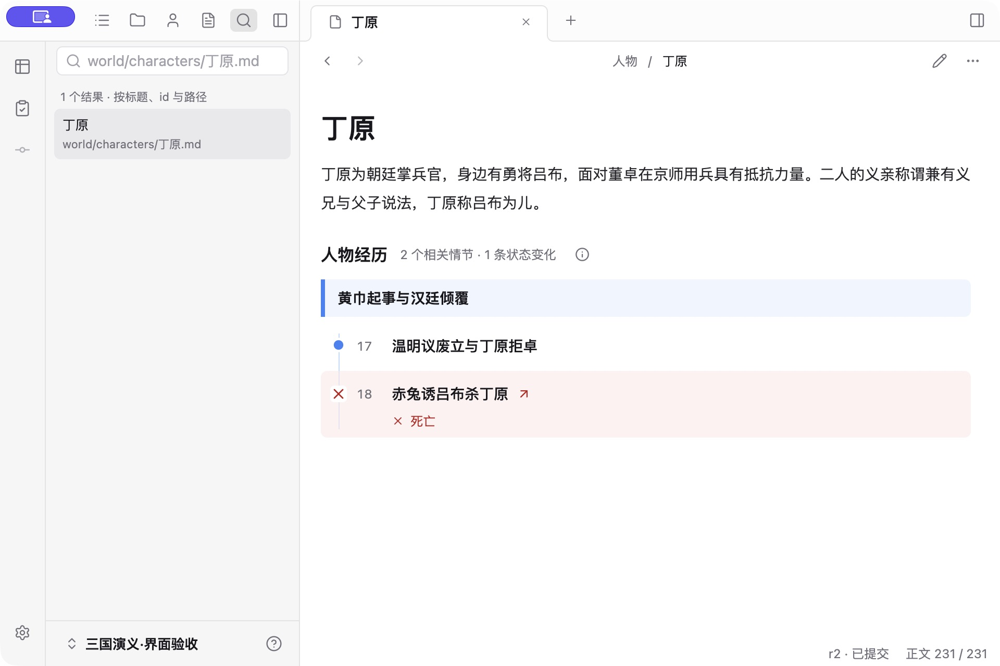

# 人物可视化：按数据量展示经历

作者选定[效果图](images/selected-design.png)后实施，延续 [ADR-0018](../../adr/0018-character-experience-visibility.md) 的直接可读原则。普通情节、秘密揭示、位置变化和死亡分别用蓝、紫、琥珀和红色，配合不同形状；所有标题与变化保持可读。

## 数据量与实际交互

原生 Electron，在已打开作品中先确认没有编辑草稿，再刷新 renderer，检查小医仙的 17 条经历与秘密节点；克鲁只有 1 条，省略概览；萧炎 150 条、15 条变化，概览与两卷定位正常，窄窗长介绍保持完整。点“莉菲泄密与围杀”能打开原始情节。完成后恢复原作品的小医仙页。实际作品截图仅供本地对照，不收入公开仓库。

公开证据使用仓库《三国演义》示例的临时副本：

| 人物 / 状态 | 验证结果 |
| --- | --- |
| 丁原：2 条经历，1 次死亡 | 普通节点与红色死亡节点均直接可读；无人物引用的死亡没有漏掉；宽窄窗均在首屏 |
| 刘备：103 条经历、7 次秘密揭示、9 卷 | 不截断完整经历；概览按 231 节真实顺序计算；卷名可点击定位，焦点跟随 |
| 空记录 | 临时测试人物不画空概览或空经历线，显示明确空态 |
| 阚泽：仅 1 次位置变化，无人物引用 | 琥珀地点标记、完整变化文字及来源跳转正常 |
| 同一情节多种变化 | 纯投影测试保留全部变化；主标记按死亡、秘密、位置优先，正文不丢弃任何一条 |

| 密集人物窄窗 | 稀疏人物窄窗 |
| --- | --- |
|  |  |

## 对照后的迭代

首轮原生截图发现标题下重复的“人物”占用一行、时间线节点及序号比标题偏高。删除重复类型，保留别名及未提交状态，节点与序号对齐标题。复验截图为上方所示最终版本。

效果图中的介绍与分布是示意；生产保留完整人物原文，分布采用全书 ordinal，不能为了与图一致而移动事实位置。小医仙的 17 条经历实际在 153 节的后段，绝不画到中间。长人物介绍仍可滚动阅读，不压成摘要、不再折叠。沿用全局字号、颜色与 Lucide，不用设计图覆盖交互。设计 QA 见[报告](../../../design-qa.md)。

## 自动验收与边界

- `npm run check` 通过。
- 工作台单元测试 68 / 68，含新增长短卷比例、顺序与 id 不同、并集、多状态及空记录投影测试。
- 完整 Electron E2E 26 / 26。新增空记录与仅状态节点；长篇用例覆盖 103 条未截断、无重复标签、九卷定位焦点、重载与窄窗不溢出。
- 首次完整回归 25 / 26：介绍与经历的包围盒分两次读取，重载恢复滚动发生在两次之间，坐标无法比较。改为同一布局帧内读取两个矩形，定向 5 / 5 通过，再完整复跑。未放宽阅读顺序断言。

宽窗 1460×940、窄窗 960×640，原生截图均为 2 倍密度。本轮验证呈现与交互，未运行真实模型或全仓单元测试，不代表自动抽取质量、完整无障碍或千级人物经历的性能验收。
