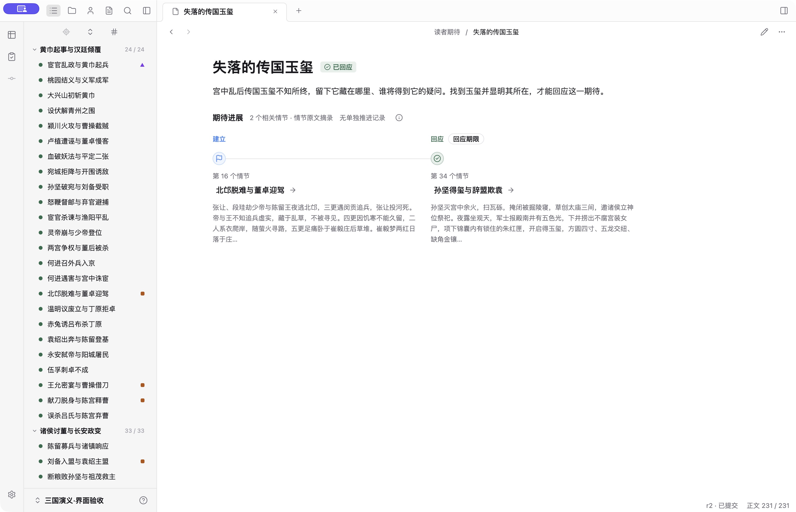
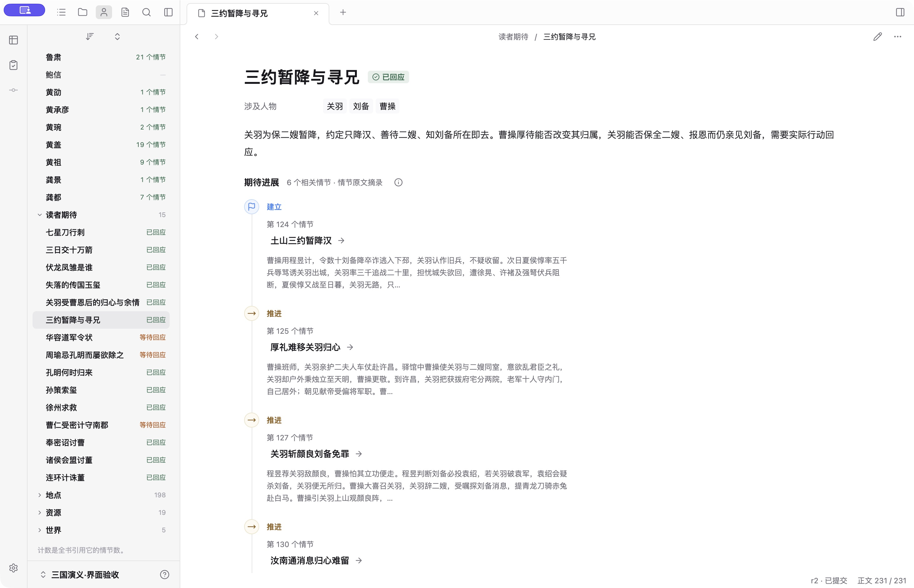
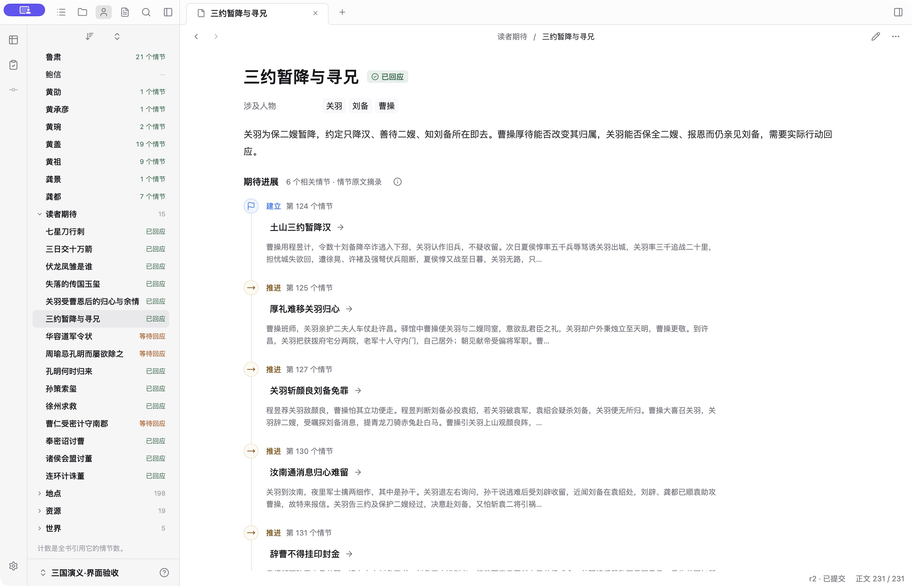
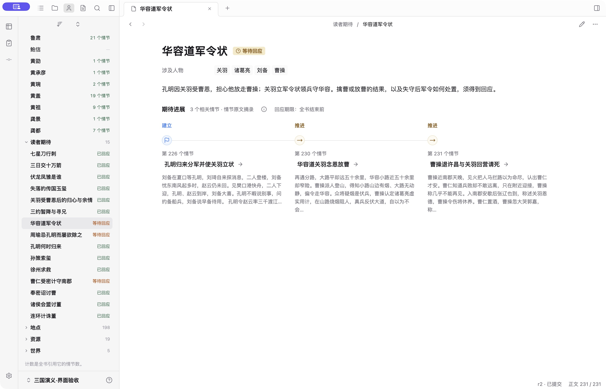
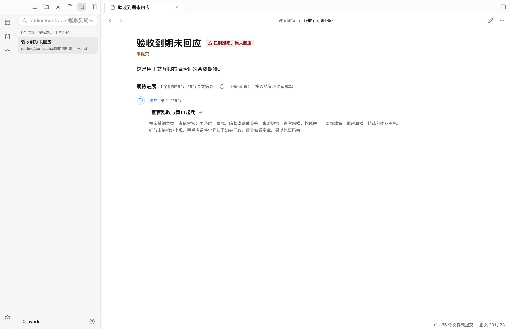
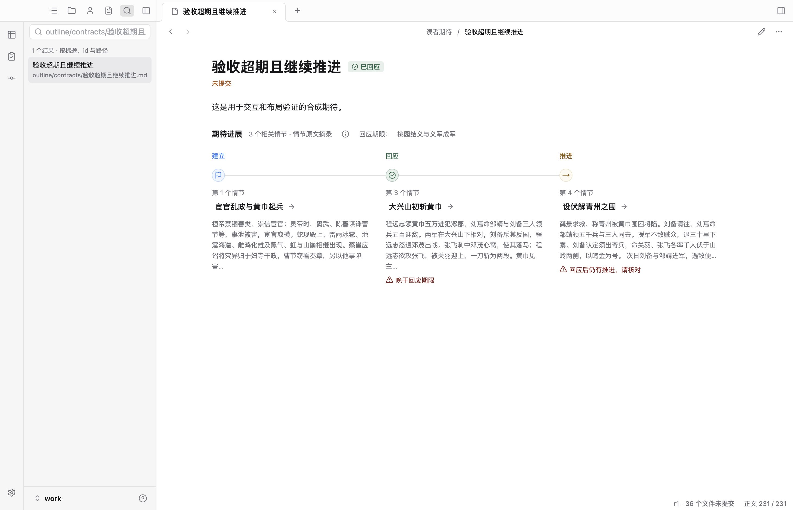
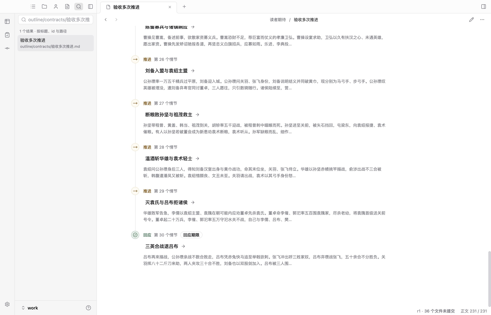
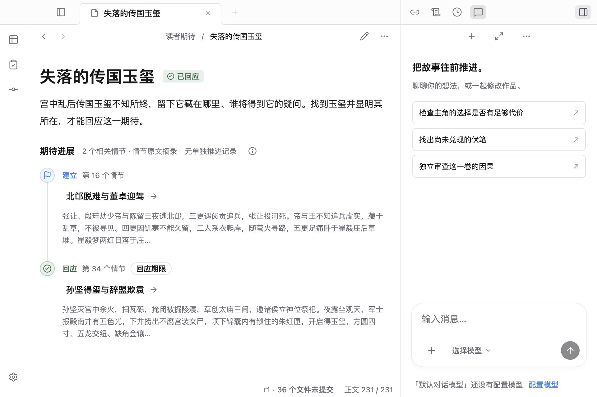

# 读者期待事件路径走查（2026-10-13）

范围：作者确认第二版效果图后，替换期待页的三阶段等宽卡片，保留其他页面各自的图形结构。只修改 renderer 与桌面验收，不改作品格式或 Canon。

## 方案与数据边界

- 同一情节只画一个节点，阶段文字全部保留；事件按全书 ordinal 排序，不按建立 / 推进 / 回应重新分组。
- 两个节点在内容区至少 560px 时横排，三个至少 840px；更多记录或窄内容区使用连续纵线。横排限定宽度，不铺满超宽窗口；全部节点可直接阅读。
- 期限与事件重合则合并标注，否则显示独立来源链接。省略期限按全书结束处理；未完待续不能把已登记的最后一节当作全书结束。
- 标题旁呈现当前回应状态，超期回应和回应后的推进在实际节点处提示。已回应只表示有记录，不是文学质量结论。
- 摘录来自情节设计首段，最多 96 个 Unicode 字符，去掉 Markdown 格式但不改写内容。它不是期待专属的语义摘要，可能包含该情节的其他事件。读取复用现有查询缓存与失效刷新，失败支持重试，标题始终可以打开来源。

## 走查与迭代

1. **少量已回应：通过。** 用公共三国的“失落的传国玉玺”验证两个节点连接，回应与期限不再重复列标题，无推进不画空卡片。Enter 打开“孙坚得玺与辞盟欺袁”；说明提示保留窗口避让。
2. **多次推进：迭代后通过。** “三约暂降与寻兄”有六个事件。初版纵向节点把阶段、序号和标题拆成三行，摘录行宽偏窄；实窗检查后把阶段与序号同排，摘录放宽到工作台阅读宽度。没有删除或折叠事件。
3. **等待回应：通过。** 实窗检查“华容道军令状”，三个节点可读，未完待续下省略期限显示“全书结束前”，不错误标为到期。
4. **边界状态：通过定向回归。** 临时作品中的合成候选覆盖空记录、单点等待、到期未回应、超期回应、回应后推进、同节三个阶段。非法生命周期只存在于测试候选，没有提交到作品。
5. **大量记录：通过定向回归。** 合成 30 个事件，全部直接显示；滚动到最后一个仍能用 Space 打开来源，验证的是布局和交互，不作为故事质量证据。
6. **宽窄转换：通过定向回归。** 960px 窗口关闭右栏后内容区仍约 624px，可以显示两个横向节点；测试进一步打开右栏，使真实内容区变窄，再验证纵向不重叠、无横向溢出及跳转。测试不把窗口宽度等同于内容宽度。
7. **横纵序号：迭代后通过。** 合并纵向序号时，实窗发现横向的序号被 utility 层的 hidden 覆盖；显隐统一放到组件层，并增加每个事件恰有一个可见序号的回归。

作者正在使用的只读已提交作品窗口已刷新，确认新页面实际加载；保留在“失落的传国玉玺”。使用公共示例及其验收副本，没有修改作者正文。

## 截图

实窗稀疏路径：

多次推进的初版与收紧后：

实窗未回应、默认全书期限：

合成边界状态与窄窗（仅用于界面验收）：

## 自动验证

- `npm run check` 全部通过，包含类型、示例 Checker、设计系统 lint 与文档链接。
- 工作台单测 72 / 72 通过，新增实际事件排序、同节阶段合并、原文摘录及默认期限回归。
- `npm run test:desktop` 完整真实 Electron 回归 30 / 30 通过，覆盖期待路径及原有的人物分布与导航、关系图、资源地点、悬停定位、版本比较等工作面。

期待路径验收覆盖来源跳转、键盘操作、窗口边界、事件几何、读取内容及控制台异常；它不能证明读屏软件全流程或语义兑现质量。
