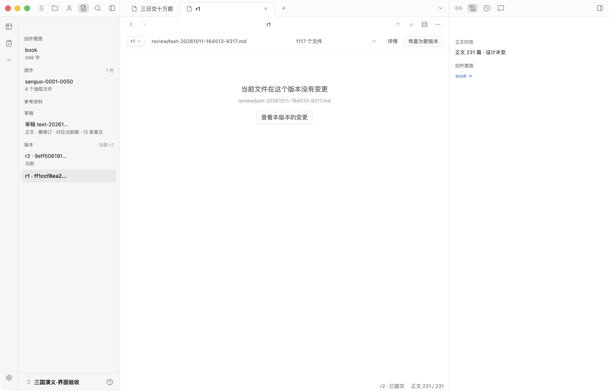
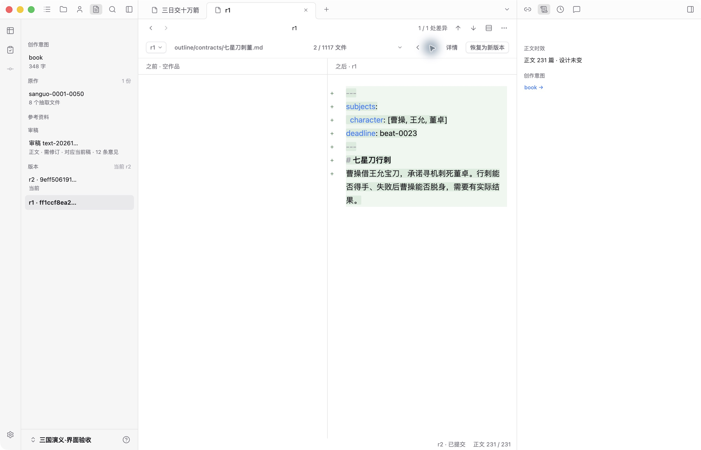
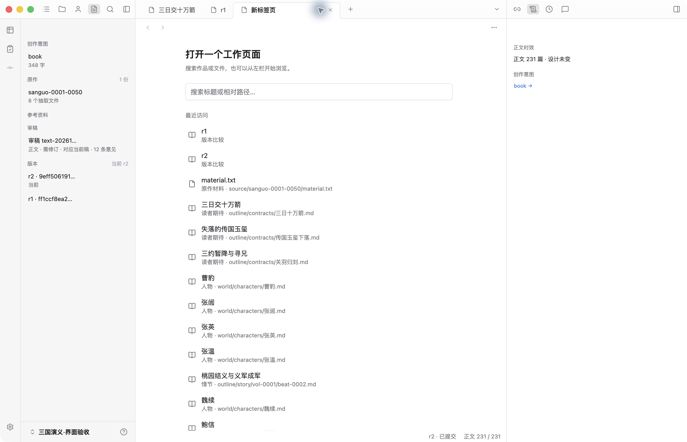
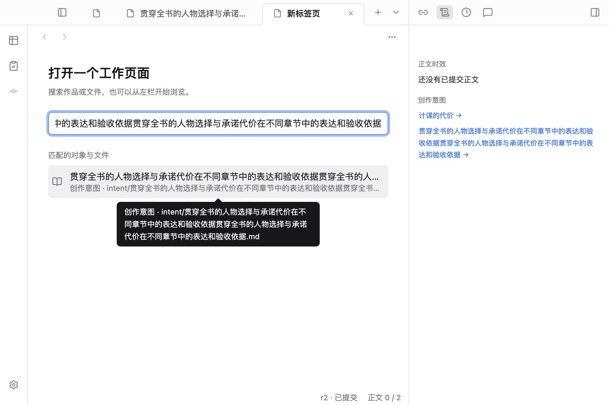
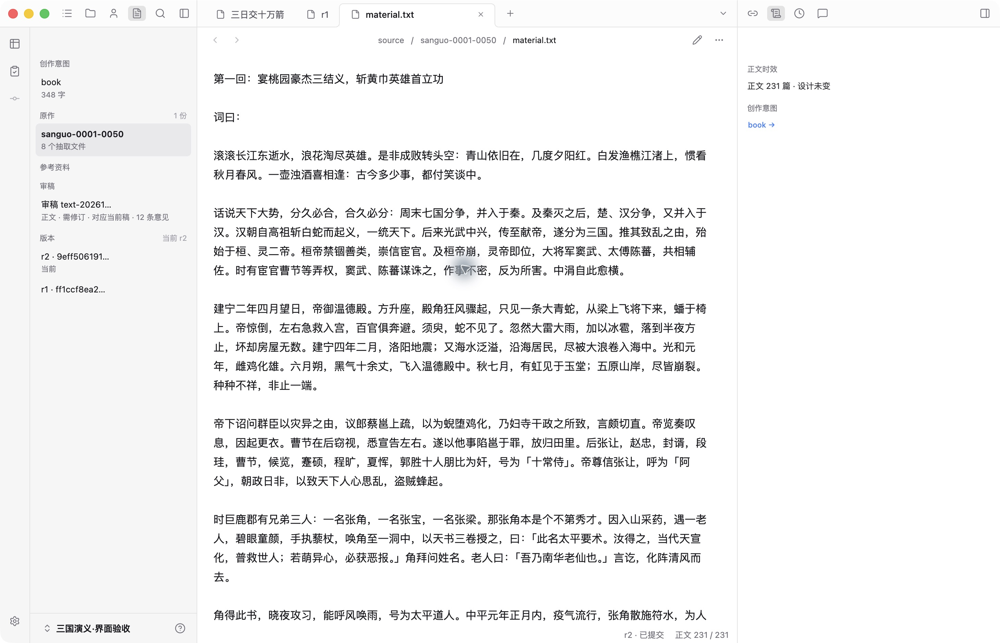

# 导航、悬停与空间走查（2026-10-13）

本轮聚焦版本比较、新标签页、材料与依据栏。使用当前 Electron 窗口的公共三国示例（231 情节、r2）和隔离测试作品；没有修改作品内容。全部截图为本次运行保存后重新打开检查的实际画面。

## 1. 版本比较：已修正导航断点

保留紧凑上下文和原有并排 / 单栏比较。原先选定文件再切换版本，文件未变更时只有说明，无法从空态直接开始核对；多个文件只能反复打开清单选择。[修改前](03-version-before.jpg)。

现在明确保留已选文件，空态提供“查看本版本的变更”；多文件有前后导航和当前序号，悬停说明目标路径或首尾边界。文件导航使用横向箭头，与顶部纵向差异导航区分。恢复仍作用于整部作品，没有点击恢复或改写历史。

隔离测试还验证键盘 Enter、禁用首尾、跨版本保留选择；原有版本回归继续覆盖读取错误重试、窄窗单栏、两侧只读和头部高度。[测试作品比较页](04-version-after.jpg)。

## 2. 新标签页：分类和截断提示已修正

原先所有对象重复“作品”，特殊页面还暴露内部地址；首屏上方空白偏多。[修改前](01-new-tab-before.jpg)。

现在按人物、情节、期待、材料等实际种类辨认；版本、检查等页面使用用途说明。减少顶部空白，保留可读行高和固定阅读宽度。搜索忽略首尾空格。标题和路径仅在截断时补全；文件名已经包含完整标题时，提示只保留路径。

键盘聚焦、Escape、鼠标悬停均经实际 Electron 测试；完整短名称不重复提示，长提示仍留在 960px 窗口内。[宽窗键盘提示](05-recent-tooltip.jpg)。

## 3. 材料与依据栏：重复内容与溢出已修正

材料本身继续使用文件阅读和路径导航。原先依据栏照抄当前第一段并显示内部类型名，原作材料通过文件入口打开后左栏也没有选中状态。[修改前](02-material-before.jpg)。

依据栏去掉这份重复摘录，保留正文时效、审稿、正向引用和写作依据。新标签使用“原作材料”；文件入口与原作列表正确联动选中状态。材料列表的截断标题通过向右提示补全，完整文字不另弹提示。

首轮截图另发现长创作意图链接溢出侧栏，且新标签提示把同一长名称重复两遍，见[迭代前](07-iteration-overflow-before.jpg)。第二轮改为侧栏内换行并去重提示，最终效果见第 2 步窄窗图。测试同时量了链接边界、内容溢出和提示方向，不只断言文字存在。

## 验证与边界

- `npm run check`：通过。
- 工作台单元测试：74 / 74。
- `npm run test:desktop`：32 / 32；新增导航测试在旧界面因缺少逐文件导航失败，实施后通过。截图迭代后定向复验 1 / 1。
- 当前工作台已刷新，现场复走跨版本空态、进入变更、下一文件、新标签分类、原作材料入口；未保存的内容不存在，未触发作品提交。
- 沿用公共按钮、提示、焦点和语义色；没有更改人物分布、期待路径或关系图。现有四向提示与边缘避让回归通过。
- 这不是全量无障碍认证：验证了键盘、可访问名称、方向与几何边界，未进行完整读屏和对比度审计。未运行真实模型或全仓单元测试。
- 版本下拉仍平铺全部 revision，长期规模问题继续在路线图维护。本轮修正的是核对和定位，不新增版本分组机制。
