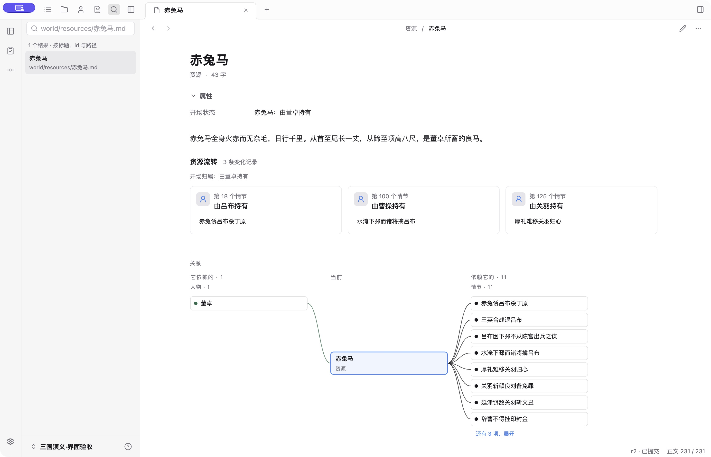
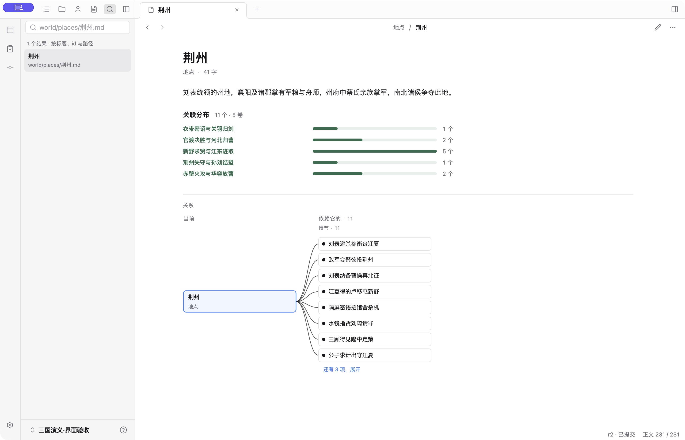
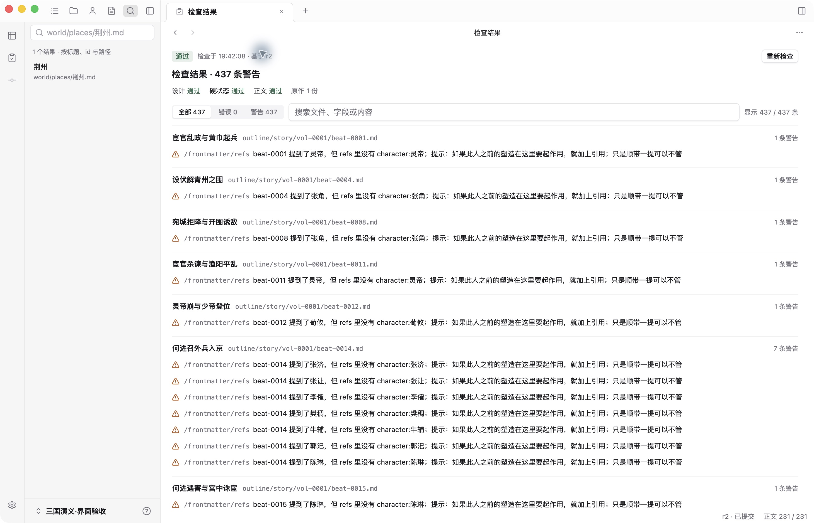
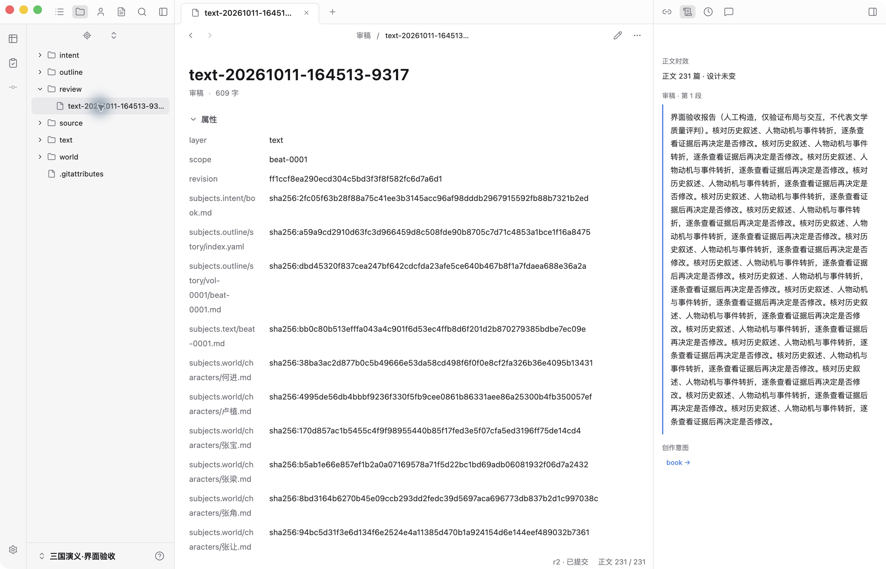
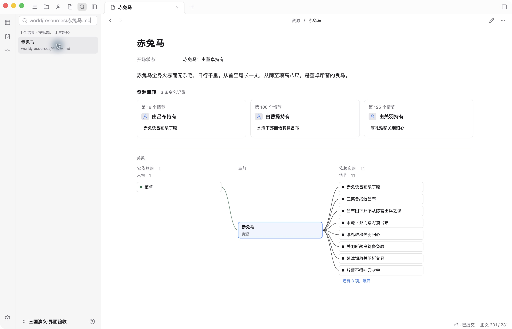
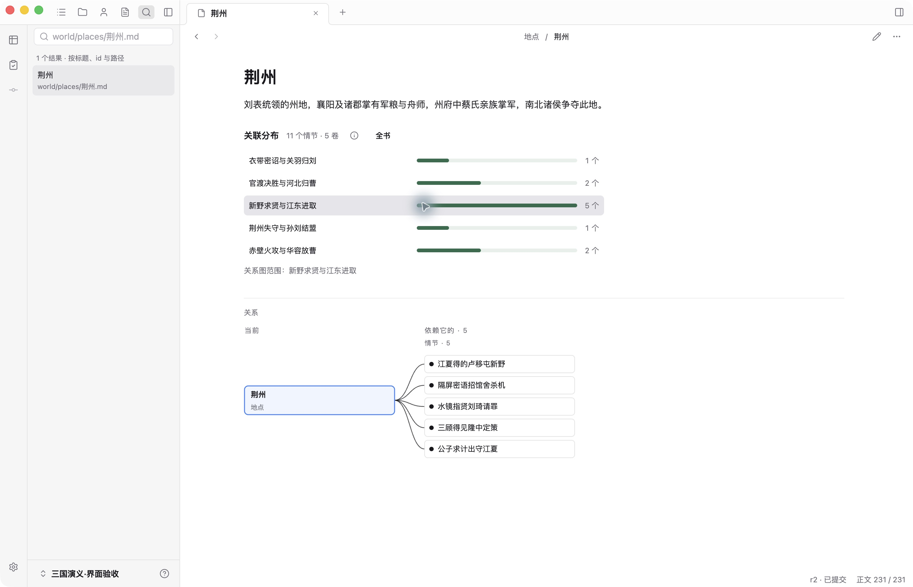
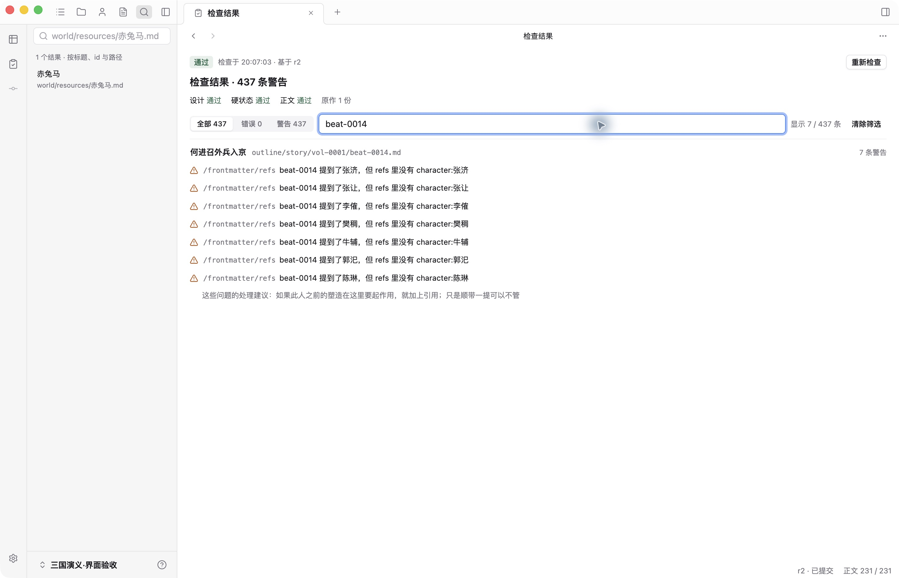
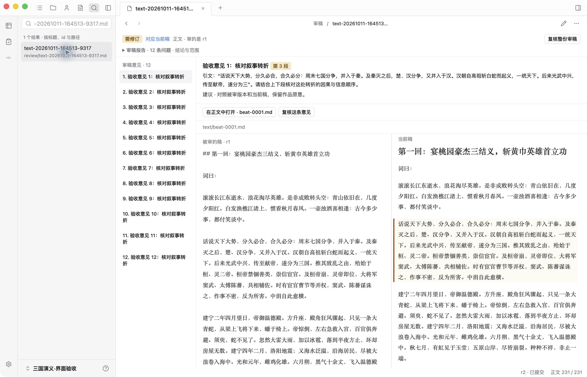
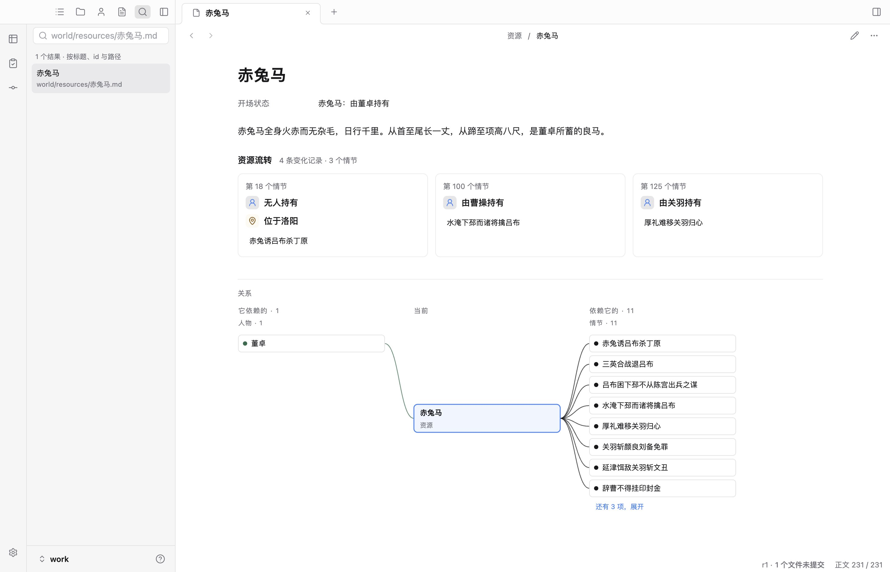
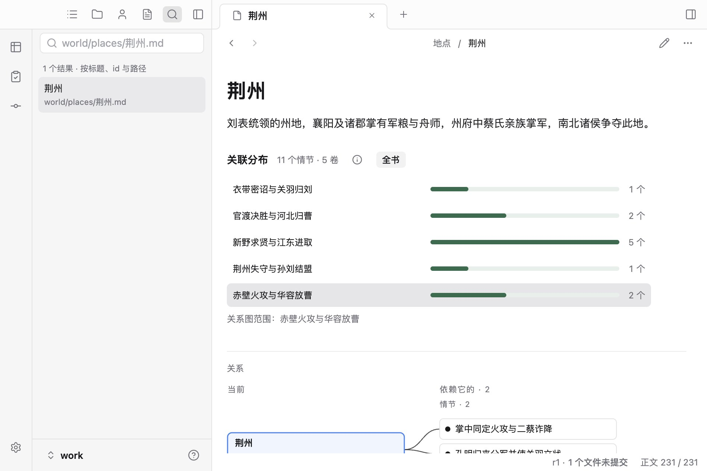

# 其他页面去重与交互走查（2026-10-13）

本轮从正在运行的桌面工作台采集页面，以公共三国验收副本和临时测试作品验证。保留人物经历、期待事件路径和对象关系图各自的图形结构。

## 发现与方案

1. **资源。** 赤兔马的开场持有人在属性与流转区重复出现，“资源 · 43 字”和“属性”标题占用空间。开场状态保留一次、直接可读；同节的归属、位置等变化归为一组，来源情节只列一次。资源仍用变化卡片与关系图，不照搬期待路径。
2. **地点。** 荆州的分布条显示五卷数量，却无法用于定位。改为按卷筛选下方的原有关系图，提供全书恢复入口；图中的其他类型关联保留，单卷和空地点不增加无效筛选。
3. **检查。** 同一文件的多条诊断重复长篇“提示”，全书未筛选还重复显示 N / N。仅在同文件的各条提示逐字相同时集中显示，具体问题、字段位置、严重程度不删；搜索仍使用完整诊断。筛选后才显示命中数。
4. **审稿。** 文件树打开已提交报告会落到通用属性页，显示大量英文键和哈希；审稿入口却能打开专用核对工作面。阅读时复用同一个审稿组件，源文件编辑仍保留。未提交或编辑中的报告不冒用已提交报告的投影。

## 走查前截图

## 验证与迭代

本轮实际打开当前桌面中的赤兔马、荆州、检查结果和人工审稿文件；截图先采集，再修改。刷新当前 renderer 后复走按卷筛选、打开来源情节、切换审稿意见与被审版本、诊断筛选。未修改这份验收作品的内容。

现场再修两处：资源的变化数与情节数相等时只留变化数，零记录不再重复写零；审稿首次加载用占位提示，避免先闪出原始属性。地点说明区分单卷与跨卷，筛选范围文案只保留卷名。

- `npm run check` 通过；工作台单元测试 74 / 74 通过。
- 完整 `npm run test:desktop` 首轮 30 / 31；唯一失败是旧长篇用例仍要求未筛选时显示“437 / 437”。更新该断言后，长篇等 6 项复验通过。最后两处显示迭代后，再复跑包含主桌面、对象、长篇和本轮新增用例的相关测试，16 / 16 通过。
- 真实 Electron 覆盖 1460×940 与 960×640：同节两项资源变化、来源键盘跳转、跨卷筛选/恢复全书、空对象、检查按文件与建议全文搜索、清除筛选、审稿阅读/编辑往返和窄窗选择恢复。已有版本、状态、设置及提示定位用例同时通过，未据此改写各页布局。
- 测试中同节多字段资源 fixture 使用“无人持有并位于洛阳”的临时候选，不是原作事实；第一版非法地同时指定持有人和地点，被 Checker 拒绝后已改正。生产截图中的审稿为人工构造，只验证布局和交互。未运行真实模型、全仓单元测试或完整读屏流程，不作文学质量结论。

## 修改后截图

以下四张来自当前生产窗口，资源开场状态只保留一次、地点条形联动图形、检查建议集中显示、审稿文件打开核对工作面：

以下两张来自隔离 Electron 验收，补充同节多变化和最小窗口：

